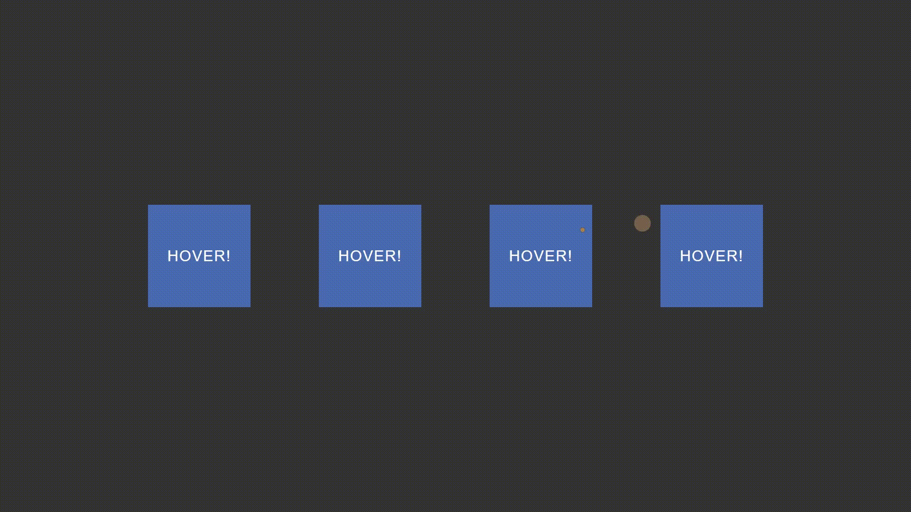

# motion-pointer

Small custom mouse cursor CSS &amp; JS library for fancy UI feature.



## How to import

If you use tools which can load your CSS & JS from node_modules e.g (webpack) you can import output `dist` file like that:

```js 
import 'motion-pointer/dist/index.css';
import 'motion-pointer/dist/index.js';
```
Else you can add `dist` files form package directly to your project and link it in HTML like that:
```html
<link rel="stylesheet" href="path_to_file/index.css">
...
<script src="path_to_file/index.js"></script>
```
## How to modify

If you want to change params of cursor or improve functionality then you can to that by overriding CSS custom properties in your project codebase.

Params you can set:

```css
--pointerColor: #d0a26460; /* cursor color in rgba/hex & value of init transparency, scope 00-FF */
--pointerHoverColor: #d0a26430;  /* cursor color in rgba/hex & value of hover transparency, scope 00-FF */
--pointerSize: 40px; /* height and width value of cursor in px */
--pointerNativeURL: url("url_to_image"); /* image asset for native cursor dot */
```

## How to use

If you want to initialize hovering on some elements on your site (it's optional) you can create array of this elements and pass it as parameter of init function:
```html
<script>
    /* Typo rule of adding elements
    * class: ".className"
    * id: "#idName"
    * tag: "tagName"
    * elementWithSpecificAttribute: "[attributeName]"
    * */
    const hoverElements = [
        "a",
        "[href]",
        "[onclick]",
        "#hoverTest",
    ];
    motionPointerInit(hoverElements);
</script>
```
Else you can just init function without parameters:
```html
<script>
     motionPointerInit();
</script>
```

## License
[MIT](https://choosealicense.com/licenses/mit/)
Created by [SG-WebDev](https://github.com/SG-WebDev)
